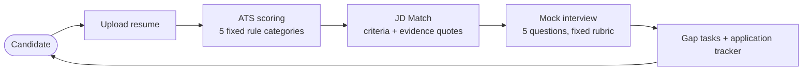
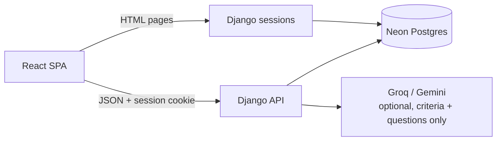

# HireSense AI

I'm the one sitting in interviews, so I built the tool I wanted on the candidate's side: upload your resume → get an ATS score with a check-by-check breakdown → match the resume against a job description, point by point, with actual quotes from your resume as proof → practise mock interviews → turn every gap into a task and keep track of your applications.

[](https://hiresense-ai-s8ih.onrender.com)


## Try it live

**[hiresense-ai-s8ih.onrender.com](https://hiresense-ai-s8ih.onrender.com)** — there's a public demo account: **`demo` / `demo1234`**.

Two honest warnings: it's on Render's free tier, which sleeps when nobody visits, so the first load after a while can take up to a minute. And uploaded resumes are stored on the service's own disk, which Render wipes on redeploys — fixing that is on the roadmap below.

## What it does

- **Resume Lab** — upload a PDF or DOCX resume. The text gets extracted, split into sections, and scored by fixed ATS rules (5 weighted categories). Every single check shows what happened and why — no mysterious final number.
- **JD Match** — paste a job description and the app drafts the criteria it should check (with AI if a key is set, otherwise a built-in extractor). **You can edit the criteria before scoring.** Then it scores each one (100 / 70 / 40 / 0), quotes the exact line from your resume as evidence, and gives you a concrete fix for every gap.
- **Mock Interview** — pick a track (HR, Technical, DSA, Frontend) and a difficulty. Five questions, one at a time, scored on a fixed rubric (relevance 30, depth 25, structure 20, confidence 15, conciseness 10). At the end you get a report: overall score, per-topic scores, and your weakest areas.
- **Applications + gap tasks** — track applications (Applied → Interview → Offer / Rejected), and turn gaps from JD Match and weak areas from interviews into a todo/doing/done checklist with one click (it skips duplicates).
- **One rule I didn't compromise on: the scores are never computed by AI.** AI can draft criteria, generate questions and write feedback — it never touches a number. Every score comes from fixed rules, so the same resume always gets the same score.

## How it flows





## The interface

The frontend is a React single-page app (Vite) talking to a Django JSON API with Django session auth (email + password, or Google/GitHub via django-allauth). The original server-rendered Django pages are still there too, at their normal URLs, on Django session login. The design is monochrome — black and white, bold type, thin borders — with a dark/light toggle that remembers your choice.

## Tech stack

[](https://skillicons.dev)

| Layer | What |
| --- | --- |
| Backend | Django 5.2 (LTS), Python 3.12 |
| Frontend | React 19 + Vite, react-router-dom |
| Database | SQLite by default; Postgres (Neon) via `DATABASE_URL` |
| Auth | Django sessions + CSRF for the API and HTML pages; Google/GitHub via django-allauth |
| AI (optional) | Groq / Gemini via plain `urllib` — no SDK dependencies |
| Production | gunicorn + WhiteNoise, Render Blueprint (`render.yaml`) |
| Tests | Django tests (scoring, flows, API, session auth, DB switch, AI fallbacks — all AI calls mocked) |

## How the code is organised

| Path | What it is |
| --- | --- |
| `config/` | Project settings + root URL map (incl. `SPA_ROUTES`, which serve the React app) |
| `api/` | JSON API for the React app (auth, dashboard, resumes, JD match, interviews, applications, tasks) |
| `frontend/` | The React app (Vite) — see `frontend/README.md` |
| `resumes/` | Resume model, upload/extraction, the scoring library (`scoring.py`, `interview.py`), Groq/Gemini clients |
| `jdmatch/` | JD Match models + HTML pages (criteria drafting, evidence, gaps) |
| `interview/` | Mock-interview sessions + HTML pages |
| `applications/` | Application tracker + gap tasks (+ the push-from-gap helpers the API reuses) |
| `accounts/` | Login/logout (HTML pages), `seed_demo` command |
| `dashboard/` | HTML dashboard view (the React dashboard reads `/api/dashboard/`) |
| `templates/` | Shared layout for the HTML pages |

A bit of history: this started as a Next.js app. That version is kept untouched on the `archive/nextjs` branch. When I rebuilt it in Django, I ported the scoring code line by line, so both versions give the same scores for the same input — including the worked example (74.0).

## Run it locally

```bash
git clone https://github.com/pawanriko/hiresense-ai.git
cd hiresense-ai

# 1. Virtual environment (Python 3.12 recommended)
python -m venv .venv
# Windows:  .venv\Scripts\Activate.ps1
# macOS/Linux:  source .venv/bin/activate

# 2. Install dependencies
pip install -r requirements.txt

# 3. Database + demo user
python manage.py migrate
python manage.py seed_demo

# 4. Run, then open http://127.0.0.1:8000/
python manage.py runserver
```

The HTML pages sign in as `demo` / `demo1234` (see `/accounts/login/`). The React app signs in with the same Django accounts (email + password, e.g. `demo@hiresense.ai` / `demo1234`) once the frontend is built: `cd frontend && npm install && npm run build`. Google/GitHub buttons appear when the OAuth env vars are set (see "Google/GitHub sign-in" below).

> **Python 3.13+ note:** `psycopg[binary]` (the Postgres driver) may not have a wheel for the newest Python yet. SQLite mode never uses it — if `pip install` fails on psycopg, install everything else and skip it: `pip install Django==5.2.19 pypdf==6.21.2 python-docx==1.2.0 requests==2.34.2 python-dotenv==1.2.4 "PyJWT[crypto]==2.15.1" cryptography==50.0.2 gunicorn==23.0.0 whitenoise==6.9.0`

**Working on the frontend** (with hot reload): run Django on :8000 as above, then `cd frontend && npm install && npm run dev` and open http://localhost:5173. Vite proxies `/api` to Django, so logging in works exactly like production.

## Tests

```bash
python manage.py test
```

The suite covers the JD Match rubric and the ATS scorer, criteria extraction, the interview checklist (including the relevance regression), upload flows, owner-only rules everywhere, the full JSON API, the session auth (register/login/logout, password reset, OAuth routes), the SQLite↔Postgres switch, and every AI provider path with mocked clients — including the rule that any AI failure falls back silently and never changes a score.

## Optional extras

Everything below is opt-in through a `.env` file next to `manage.py` (copy `.env.example`). With no keys at all, everything still works on SQLite with the demo login — the OAuth buttons simply stay hidden until their env vars are set.

### Google/GitHub sign-in (django-allauth)

Email + password sign-in needs no keys. Google/GitHub sign-in runs
through django-allauth under `/accounts/` and ends in a normal
Django session.

1. Create your own Google and GitHub OAuth apps. Callback URLs:
   `https://<app>.onrender.com/accounts/google/login/callback/` and
   `https://<app>.onrender.com/accounts/github/login/callback/`
   (use `http://127.0.0.1:8000/...` equivalents for local dev).
2. Set `GOOGLE_OAUTH_CLIENT_ID` / `GOOGLE_OAUTH_CLIENT_SECRET` and/or
   `GITHUB_OAUTH_CLIENT_ID` / `GITHUB_OAUTH_CLIENT_SECRET` in `.env`
   (or on Render). A button appears only when both of its values are
   set.
3. Accounts created before this auth change keep their data: sign in
   with Google/GitHub using the same email, or use "Set a new
   password" on the login page (needs the `EMAIL_*` vars in
   production; locally the reset link prints to the server console).

### Neon Postgres

Set `DATABASE_URL` in `.env` and the app switches from SQLite to Postgres — same models, same migrations, SSL on by default (`sslmode=require`). Use the **pooled** connection string from your Neon project's dashboard (the `-pooler` host). The live site runs on Neon (moved off Render's expiring free database in Nov 2026).

⚠️ Use a **fresh** Neon project for this app, not one that already has another app's data in it. SQLite data doesn't carry over (run `migrate` + `seed_demo` again), and uploads stay on local disk either way. Delete the `DATABASE_URL` line and restart to switch back.

### AI providers (Groq / Gemini)

Set `GROQ_API_KEY` and/or `GEMINI_API_KEY` in `.env` (free keys from console.groq.com and aistudio.google.com). Optional extras: `GROQ_MODEL` (default `llama-3.3-70b-versatile`), `GEMINI_MODEL` (default `gemini-2.0-flash`), and `AI_PROVIDER` — set it to `groq` or `gemini` to pin one provider. Leave it unset and it uses Groq first if that key exists, else Gemini. If you pin a provider and its key is missing, you get no AI at all — it never silently switches to the other one.

With a key set: JD Match drafts its criteria with AI, interview questions are generated from the JD + company + track + difficulty, and answers get AI feedback on the same rubric. And if the AI call fails for any reason, the app falls back to the built-in questions/checklists without telling you anything broke. The scores stay rule-based either way.

## Deploying to Render

The repo has a Blueprint (`render.yaml`): one web service (Django + the built React app, served by WhiteNoise). The database is Neon Postgres, connected through `DATABASE_URL` set in the dashboard — it is not created by the Blueprint.

1. render.com → connect GitHub → **New → Blueprint** → pick this repo. Render creates both resources from `render.yaml`.
2. The build installs the Python and Node dependencies, builds the React app, collects static files, migrates, and runs `seed_demo` — that's how the demo login exists on the live database, because Render's Shell is paid-only and the build has to do the seeding.
3. After pushing code later, deploy it with **Manual Deploy → Deploy latest commit** on the service page — Blueprint services don't auto-deploy on every push. If `render.yaml` itself changed, run a **Blueprint Manual sync** first so the new build command is picked up.
4. Env vars on the live service: `GOOGLE_OAUTH_CLIENT_ID` / `GOOGLE_OAUTH_CLIENT_SECRET`, `GITHUB_OAUTH_CLIENT_ID` / `GITHUB_OAUTH_CLIENT_SECRET` (OAuth buttons), and the `EMAIL_*` set (password-reset mail). Optional AI vars: `GROQ_API_KEY`, `GEMINI_API_KEY`.

Production notes: `DEBUG=False`, `SECRET_KEY` generated by Render, secure cookies + `SECURE_PROXY_SSL_HEADER` when not debugging, and the SPA and `/api` share one origin so no CORS setup is needed.

## Roadmap

- **Supabase Storage for uploads**, so resumes survive redeploys.
- **Linking interview sessions to a resume** (the old Next.js version did this; the Django version doesn't yet).
- Two things the original had that I haven't ported: resume rewrites and cover letters.

## Author

**Pawan Kumar** — BCA student, New Delhi.
GitHub: [pawanriko](https://github.com/pawanriko) · LinkedIn: [in/pawanriko](https://www.linkedin.com/in/pawanriko)

## License

MIT — see [LICENSE](LICENSE).
