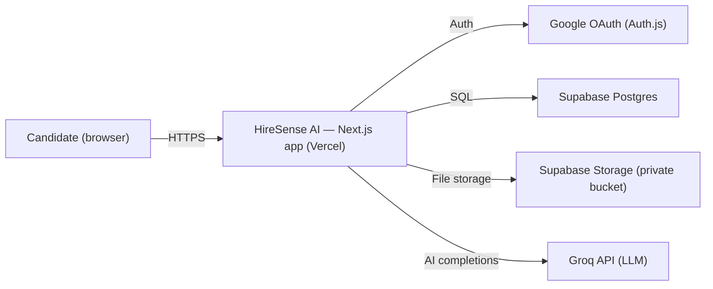
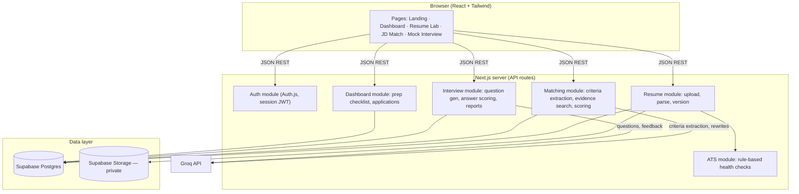

# 02 · Architecture — HireSense AI

## Architectural style
**Modular monolith.** One Next.js application containing the UI, API routes, and domain modules (auth, resumes, matching, interviews, dashboard). Modules are isolated in code (`/modules/*`) with clear boundaries, so any module could be extracted later — but there are no microservices, no message broker, and no Kafka. This is deliberate: solo builder, free-tier deployment, interview-explainable system.

## System context

## Component diagram

## Key flows (summary — full detail in `04-workflows.md`)
1. **Resume ingestion:** upload → virus/MIME/size checks → private storage → parse (PDF/DOCX → structured sections) → ATS health checks → results stored.
2. **JD matching:** JD text → one LLM call extracts structured criteria + suggested weights → candidate reviews/edits → deterministic evidence search over the parsed resume → rubric scoring → gap list.
3. **Mock interview:** resume + JD context → LLM generates questions one at a time → candidate answers → rubric feedback per answer → session report.

## Deployment topology
| Tier | Where | Notes |
|---|---|---|
| Web + API | Vercel (free) | Next.js app; API routes are serverless functions |
| Database | Supabase Postgres (free) | Row-level access by `user_id` |
| Files | Supabase Storage (free) | Private bucket; files served via short-lived signed URLs |
| AI | Groq API (free tier) | Server-side key only; never exposed to the browser |

## Security boundary (summary — detail in `06-security-and-privacy.md`)
- The browser talks **only** to Next.js API routes. Direct browser access to the database or storage is prohibited.
- Every API route requires a valid session; every query is scoped to the session's `user_id`.
- Resume files are private; downloads happen via short-lived signed URLs generated server-side.
- The Groq API key exists only as a server environment variable.

## Scalability posture (honest)
Designed for portfolio/demo scale (hundreds of users). Known limits and the upgrade path for each:
- **Parsing is synchronous** in the API route → move to a background job queue if file sizes/timeouts grow.
- **Groq free-tier rate limits** (checked 23 Oct 2026: ~30 req/min, 1,000 req/day on main chat models) → cache JD criteria extractions; queue interview generation.
- **Vercel function timeouts** → parsing and AI calls are kept short and chunked by design.
