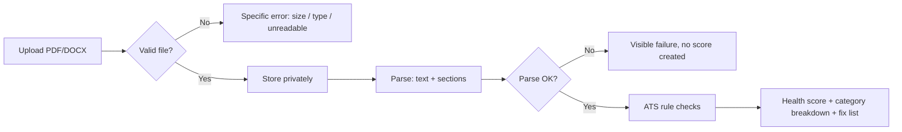
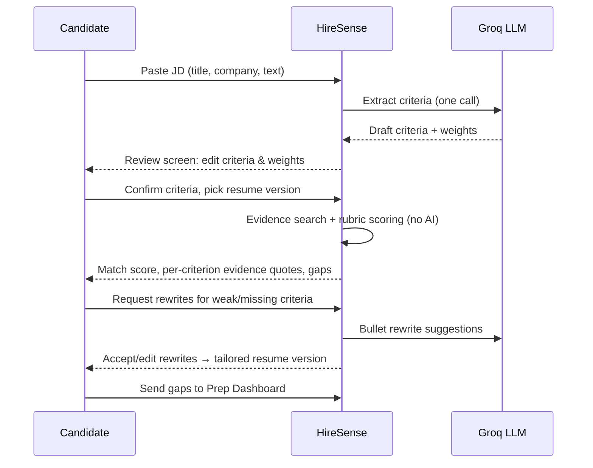

# 04 · Workflows — HireSense AI

## 1. Onboarding
1. Candidate lands on the homepage → sees the before/after match example → clicks **Try the demo** (demo login) or **Sign in with Google**.
2. Auth.js completes OAuth → user row created → empty dashboard with three clear first actions: Upload resume · Paste a JD · Try a sample.
3. A built-in **sample resume + sample JD** pair is always available so the full loop works without the candidate's own files.

## 2. Resume Lab workflow

Candidate reviews the breakdown, applies fixes in their own editor, and uploads a **new version** (old versions are kept; scores are comparable across versions).

## 3. JD Match workflow (core loop)

States of a match analysis: `draft_criteria → criteria_confirmed → scored → gaps_generated`. An analysis is immutable once scored; changing criteria creates a new analysis (history is a feature — progress over time is visible).

## 4. Mock interview workflow
1. Candidate picks: resume version + JD (optional) + track (HR / Technical / DSA / Frontend) + difficulty.
2. Session starts; the engine asks **one question at a time**, grounded in the resume/JD, tracking which criteria have been covered.
3. Each answer is scored against the fixed rubric (relevance 30 / depth 25 / structure 20 / confidence cues 15 / conciseness 10) and returned with brief feedback + a stronger-answer outline.
4. After the final question: **report** — overall score, per-topic breakdown, two weakest areas, model outline for the weakest answer, and one-click revision tasks to the dashboard.
Session states: `in_progress → completed` (or `abandoned` if left mid-way; resumable while `in_progress`).

## 5. Prep Dashboard workflow
- **Checklist:** auto-generated from the latest analysis gaps + interview weak areas; candidate can add manual tasks, reorder, and check off.
- **Progress:** match score per JD over time, latest ATS score per resume version, mock scores trend.
- **Applications:** candidate logs applications and moves them Applied → Interview → Offer/Rejected; each application links its JD and best match analysis.

## 6. Demo workflow (for portfolio visitors)
Demo login → pre-loaded sample resume, sample JD, one completed analysis (score 62/100 example), and one completed mock session → visitor can run a *new* match and a *short* mock interview live. Demo data resets nightly; demo users cannot see each other's data.

## 7. Error & edge workflows
| Case | Behaviour |
|---|---|
| Corrupt / image-only PDF | Parse fails visibly: "No readable text found — try a text-based PDF or DOCX" |
| JD with no extractable criteria | Candidate is told plainly and offered manual criteria entry |
| Groq rate limit / outage | Scoring still works (it's deterministic); AI features queue a friendly "try again in a moment" state |
| Resume with no Skills section | Evidence search still runs on all sections; ATS flags the missing section |
| Duplicate upload | Allowed as a new version; dashboard notes the identical file hash |
